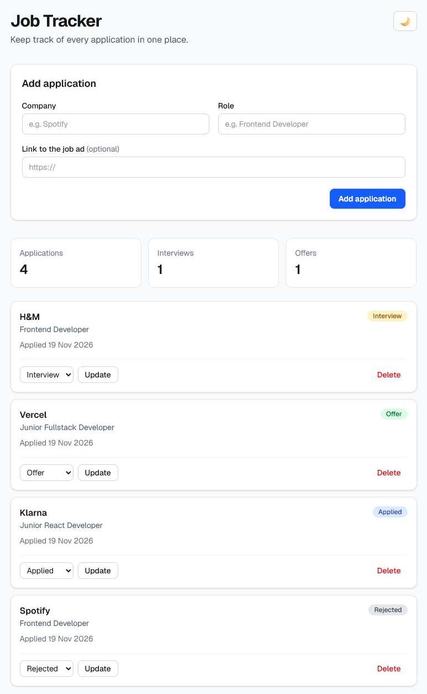
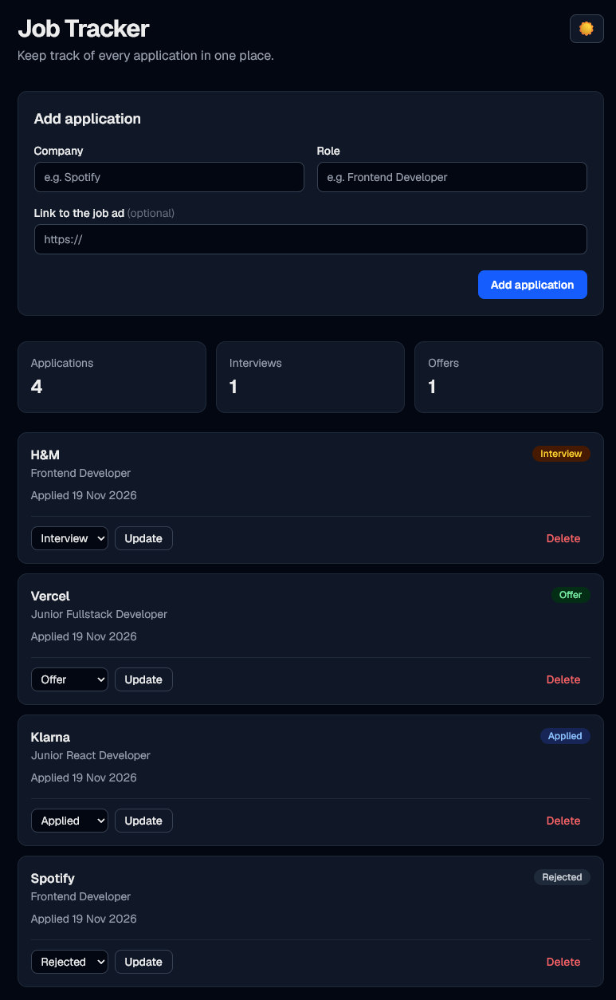

# Job Tracker

A full-stack web app for keeping track of job applications: company, role, link to the job ad and status (Applied → Interview → Offer / Rejected). I built it to learn full-stack development with Next.js, a database and Docker, and I use it myself while I'm looking for a job.

By [Alexander Jonasson](https://github.com/alexanderjonasson).

<p>
  
  
</p>

## Features

- Add job applications with company, role and an optional link to the ad
- Change the status of each application, with a colored badge per status
- See how many applications, interviews and offers you have
- Delete applications
- Light and dark mode, with a toggle that remembers your choice
- All data is stored in a PostgreSQL database
- The whole app (database, migrations and Next.js) starts with one command using Docker Compose

## Tech stack

- Next.js 16 (App Router) with TypeScript
- React Server Components and Server Actions
- Prisma ORM
- PostgreSQL
- Tailwind CSS
- Docker and Docker Compose

## How it works

The home page is a Server Component that reads the applications straight from the database with Prisma, so the database connection never reaches the browser. The forms use Server Actions: they call functions on the server directly, without a separate API, and the input is validated on the server before anything is saved.

Docker Compose runs three services:

- `db`: PostgreSQL, with a health check
- `migrate`: applies the Prisma migrations once the database is ready, then exits
- `app`: the Next.js app, built with a multi-stage Dockerfile and `output: "standalone"` to keep the image small

## Getting started

You need Docker Desktop.

```bash
git clone https://github.com/alexanderjonasson/job-tracker.git
cd job-tracker
cp .env.example .env
docker compose up --build
```

Set your own password in `.env` (in both places), then open [http://localhost:3000](http://localhost:3000).

### Local development

To work on the code with hot reload, run only the database in Docker and Next.js on your machine (you also need Node.js):

```bash
npm install
docker compose up -d db
npx prisma migrate dev
npx prisma generate
npm run dev
```

## Next steps

- Notes for each application
- Filter applications by status
- Edit company, role and link
